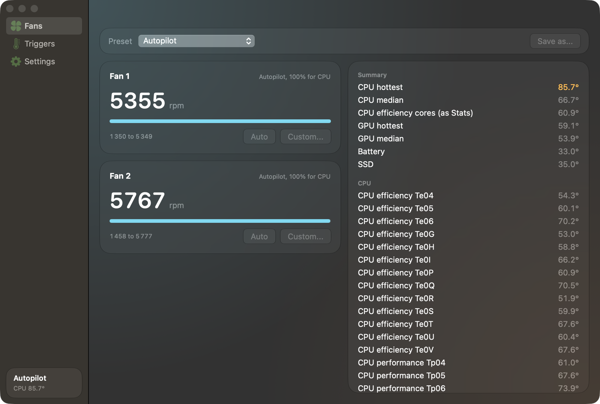
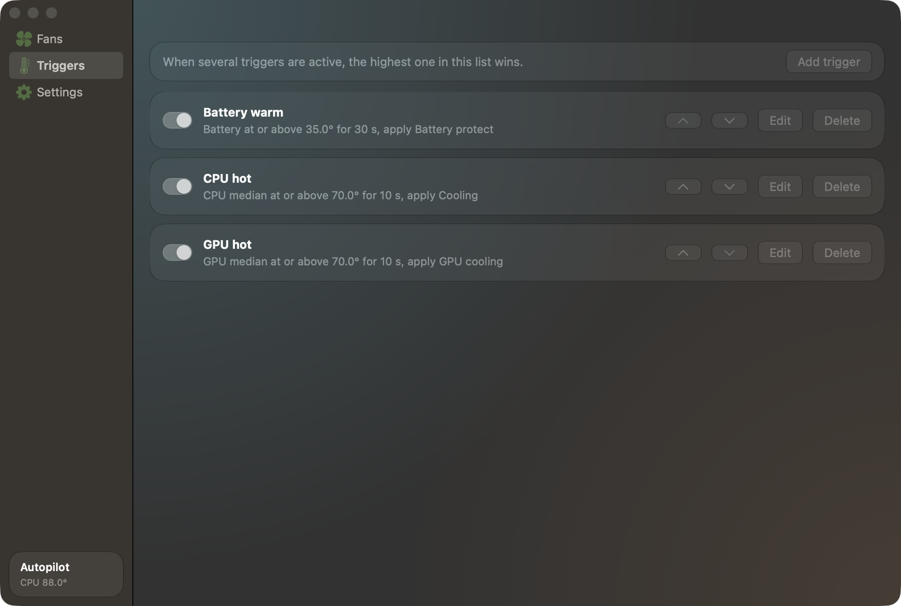
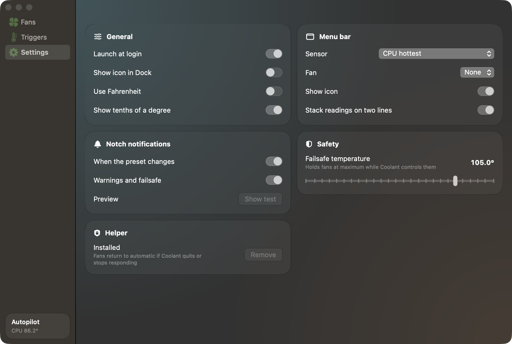
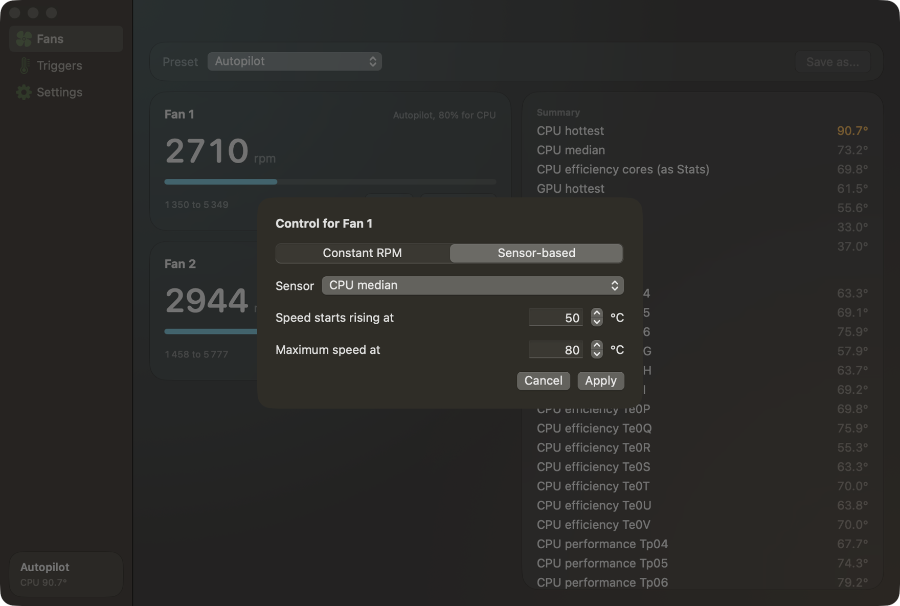

<p align="center"></p>

# Coolant

[](https://github.com/arterialist/coolant/actions/workflows/ci.yml)
[](LICENSE)


Fan control for Apple Silicon MacBooks. It lives in the menu bar, runs per-fan temperature curves, switches presets when a CPU, GPU or battery temperature crosses a limit, and reports changes in the notch.

<p align="center"></p>
<p align="center"></p>

<table>
  <tr>
    <td></td>
    <td></td>
  </tr>
  <tr>
    <td align="center">Triggers</td>
    <td align="center">Settings</td>
  </tr>
</table>

<p align="center"></p>

> [!WARNING]
> Coolant writes to your Mac's System Management Controller through a root helper. It has only been tested on a 16-inch MacBook Pro with an M3 Pro (`Mac15,7`) on macOS 27.2. Sensor names and the fan write sequence can differ on other chips. Use it at your own risk, and see [Safety](#safety).

## Features

- Automatic, full speed, constant RPM or temperature curve for each fan
- Unlimited saved presets
- Autopilot, which cools whichever part needs it most ([how it decides](docs/AUTOPILOT.md))
- Triggers on any temperature sensor, with hold time, hysteresis and priority order
- Notch notifications, with a top-of-screen fallback on displays without a notch
- Menu bar readout of any summary sensor and fan
- Celsius or Fahrenheit, launch at login, optional Dock icon

## Install

### Download

Get the latest zip from [Releases](https://github.com/arterialist/coolant/releases), unzip it and move `Coolant.app` to `/Applications`.

Releases are not notarized because the project has no Apple Developer ID, so macOS will refuse to open a downloaded copy. Check the published SHA-256 first, then clear the quarantine flag:

```sh
shasum -a 256 Coolant-*.zip
xattr -dr com.apple.quarantine /Applications/Coolant.app
```

Building from source avoids this step, and it means the root helper is code you compiled yourself.

### Build from source

Needs macOS 14 or later on Apple Silicon. The Xcode Command Line Tools are enough.

```sh
git clone https://github.com/arterialist/coolant.git
cd coolant
./scripts/build.sh --install
```

### First run

Open Coolant and press **Install helper**. macOS asks for your password once. Without the helper the app only monitors.

A new install starts on the Automatic preset with every trigger switched off, so macOS keeps control of the fans until you choose otherwise. Quit other fan control apps first. Coolant stops writing while Macs Fan Control is running.

## How it works

Fan state lives in the System Management Controller, reached through the `AppleSMC` IOKit driver. Reading needs no privileges. Writing needs root.

| Key | Meaning |
| --- | --- |
| `FNum` | Fan count |
| `FnAc`, `FnMn`, `FnMx` | Current, minimum and maximum RPM |
| `Ftst` | Set to 1 to allow manual control |
| `FnMd` | 1 is manual, 0 is automatic |
| `FnTg` | Target RPM, little-endian float |

`coolantd` is a small root LaunchDaemon. It takes newline-delimited JSON on a Unix socket that only the installing user can open. It can do two things: set a fan inside the SMC's own minimum and maximum, or return a fan to automatic. The app runs the control loop every 2 seconds.

Stopped fans refuse manual mode with SMC status 130 until they spin up, about 7 seconds on the test machine. The app retries each tick and only reports failures that last over 20 seconds.

### Reading the temperatures

Apple does not document these keys, so no tool can prove its absolute numbers. Sensor groups here come from loading each chip and watching which keys moved on an M3 Pro:

- `Tp` and `Te` follow CPU load, `Tg` follows GPU load, and `TB0T` to `TB2T` match the battery gas gauge.
- CPU keys come in per-core sets where some are a fixed offset from another. Averaging them counts the same sensor several times, so Coolant reports a median.
- CPU hottest matches the firmware key `TCMz` to within 0.02 °C.

Other monitors can read quite differently. On an M3 Pro, Stats finds only `Te05`, `Te0P` and `Te0S`, which are efficiency cores. Coolant has a row called "CPU efficiency cores (as Stats)" for comparing the two.

## Safety

- The helper returns every fan to automatic if the app quits, crashes or misses heartbeats for 8 seconds, and when the helper itself stops.
- Fans return to automatic before sleep.
- While Coolant controls a fan, holding the failsafe temperature (105 °C by default) for 3 readings in a row forces maximum speed.
- A curve whose sensor disappears runs its fan at maximum.
- Coolant cannot set a fan below the minimum the SMC reports.

A curve with low speeds and high limits can still let your Mac run hotter than macOS would. If you notice a burning smell, stop the workload, unplug the charger and get the machine inspected. Fan software cannot fix that.

## Uninstall

Press **Remove helper** in Settings, quit Coolant, then:

```sh
rm -rf /Applications/Coolant.app "$HOME/Library/Application Support/Coolant"
rm -f "$HOME/Library/LaunchAgents/com.arterialist.coolant.plist"
```

## Command line

`coolantctl`, inside the app bundle at `Contents/MacOS/`, needs no helper for reading:

```sh
coolantctl status                      # fans and summary temperatures
coolantctl hold <fan> <rpm> <seconds>  # test the helper, then revert to automatic
```

## Limitations

- Apple Silicon only.
- Tested on one machine. M1, M2 and M4 reports are especially useful, so please [open a hardware report](https://github.com/arterialist/coolant/issues/new/choose).
- External drive temperatures are not supported.

## Contributing

See [CONTRIBUTING.md](CONTRIBUTING.md). Report vulnerabilities through [SECURITY.md](SECURITY.md), not public issues.

## License

[MIT](LICENSE). Coolant is an independent project and is not affiliated with Apple, CrystalIDEA or the Stats project.
